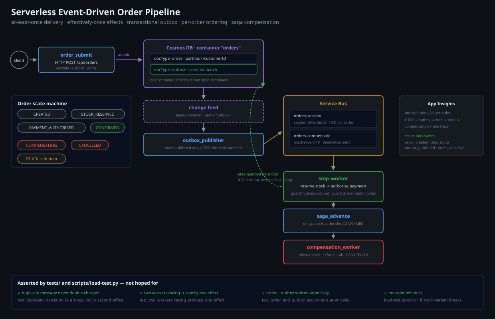

# Serverless Event-Driven Order Pipeline on Azure

An order pipeline built for the failure modes that actually happen: duplicate
messages, out-of-order delivery, partial failures across three services, poison
messages, and a worker that dies mid-transaction.

> **Why this exists:** "event-driven" is a diagram. The engineering is in the
> delivery guarantees — at-least-once means *your handler will run twice*, so
> idempotency is not optional, and compensating actions are not optional either.

---

## Architecture



```
  POST /api/orders
        │
        ▼
┌──────────────────────┐    writes order + outbox row in ONE transaction
│ order_submit (HTTP)  │───────────────────────────────────────────────┐
└──────────────────────┘                                               │
                                                                       ▼
                                                          ┌─────────────────────┐
                                                          │ Cosmos DB           │
                                                          │  orders             │
                                                          │  outbox  ← same txn │
                                                          └──────────┬──────────┘
                                                                     │ change feed
                                                                     ▼
                                                          ┌─────────────────────┐
                                                          │ outbox_publisher    │
                                                          │ (change feed → SB)  │
                                                          └──────────┬──────────┘
                                                                     │
                                            ┌────────────────────────┼───────────────┐
                                            ▼                        ▼               ▼
                                   ┌─────────────────┐      ┌──────────────────┐
                                   │ orders-session  │      │ orders-compensate│
                                   │ (FIFO, sessions)│      │ (compensation)   │
                                   └────────┬────────┘      └──────────────────┘
                                            │
                              ┌─────────────┴──────────────┐
                              ▼                            ▼
                     ┌─────────────────┐          ┌─────────────────┐
                     │ inventory_worker│          │ payment_worker  │
                     │ reserve stock   │          │ charge card     │
                     └────────┬────────┘          └────────┬────────┘
                              │  ┌──────────────────────┐   │
                              └─▶│  saga coordinator    │◀──┘
                                 │  (order state doc)   │
                                 └──────────┬───────────┘
                                            │ all steps ok?
                                ┌───────────┴────────────┐
                                ▼                        ▼
                        orders-confirmed          orders-compensate
                        (publish event)           (release stock / refund)

  Every function → Application Insights (distributed traces, operation_id
  propagated through Service Bus application properties)
```

### The saga

The order is a **saga**, not a distributed transaction. Steps have explicit
compensations, and the state document is the single source of truth for which
compensation to run.

```
  CREATED ──▶ STOCK_RESERVED ──▶ PAYMENT_AUTHORISED ──▶ CONFIRMED
     │              │                    │
     │              │                    └── payment fails ──▶ COMPENSATING
     │              └── stock fails ────────────────────────▶ COMPENSATING
     └── validation fails ──────────────────────────────────▶ REJECTED

  COMPENSATING ──▶ REFUNDED + STOCK_RELEASED ──▶ CANCELLED
```

Each transition is a **conditional write** on the order document
(`_etag`). A duplicate message that arrives after a transition already happened
is a no-op, not a second charge. That single rule is what makes at-least-once
delivery safe.

---

## The four hard problems, and how each is solved

### 1. Duplicate delivery (at-least-once → effectively-once)

Service Bus delivers at least once. Every handler therefore:

1. reads the order document and checks the current state,
2. writes either the new state **or** a `processed` marker, conditioned on
   `_etag` (Cosmos DB returns 412 if another instance already moved it),
3. uses the *operation id* from the message as the idempotency key for the
   external call (payment provider), so even a retried charge is not a second
   charge.

Covered by `tests/test_idempotency.py`, including the two-consumer race.

### 2. Ordering

`orders-session` is a **Service Bus session-enabled queue** with
`session_id = order_id`. Messages for one order are processed in order, one at
a time; different orders proceed in parallel. The alternative — an ordering
guarantee across the whole queue — would serialise the entire system to protect
a property only needed per order.

### 3. The dual-write problem (transactional outbox)

Writing to the database and publishing to a queue are two systems. If the
publish fails after the DB commit, the order is stuck; if the DB commit fails
after the publish, you have a phantom order.

The outbox solves this: the order write and the outbox row are **documents in the
same container** (`docType: "order"` / `docType: "outbox"`), so they land in one
Cosmos DB transactional batch — same container, same partition key
(`customerId`). A batch cannot span containers, which is precisely why the outbox
is not a separate container.
A change-feed function then moves outbox rows to Service Bus. Publish failures
retry from the change feed; duplicates are harmless because of problem 1.

### 4. Poison messages

A handler that throws on a message it can never process will retry forever.
Policy: `maxDeliveryCount = 5`, then the message goes to the
`orders-session/$deadletterqueue`. A separate function moves dead-lettered
messages into an `orders-dlq` container with the full failure context, and
raises an alert. Nothing is silently discarded, and nothing loops forever.

---

## Design decisions & trade-offs

**Functions Flex Consumption, not Premium.**
Flex consumption has per-instance concurrency, VNet integration and no cold
start on always-ready instances. Premium is the choice at high sustained load;
here the traffic profile is spiky, so Flex. The trade-off is fewer tuning knobs.

**Cosmos DB, not SQL, for the order store.**
The outbox pattern needs a multi-document transaction *with* a change feed. A
Cosmos DB transactional batch within one partition key gives exactly that in a
single round trip. With SQL Server you would need a separate table plus polling,
and you would be solving the same problem with more moving parts.

**Session queue for ordering instead of a single partition.**
Per-order ordering with cross-order parallelism. The cost: a session-enabled
queue cannot use the same competing-consumer throughput, and a stuck session
blocks that order only (which is correct).

**`outbox_publisher` on the change feed, not a timer.**
Change feed is push-based and ordered within a partition. A polling timer would
add latency and duplicate work across instances.

**Compensation is a queue, not a direct function call.**
Compensations must survive a function crash mid-saga. Putting them on a queue
means the retry policy of the queue applies, and the dead-letter path catches
the un-compensatable cases.

**No orchestration framework (Durable Functions).**
Durable Functions would make the saga trivial to write and harder to operate
(state lives in a storage account you must reason about during an incident).
Explicit state documents in Cosmos DB keep the saga observable with a single
query, which matters more in production than code brevity.

---

## Repository layout

```
azure-serverless-order-pipeline/
├── src/
│   ├── functions/
│   │   ├── order_submit/          # HTTP: validate, write order + outbox atomically
│   │   ├── outbox_publisher/      # change feed → Service Bus
│   │   ├── inventory_worker/      # reserve stock (session queue)
│   │   ├── payment_worker/        # authorise payment (idempotent external call)
│   │   ├── saga_advance/          # evaluate state, publish next step or compensate
│   │   ├── compensation_worker/   # release stock / refund
│   │   └── order_status/          # HTTP: read model for the client
│   └── shared/
│       ├── models.py              # Order, OrderState, events
│       ├── repository.py          # Cosmos access with etag-guarded transitions
│       ├── messaging.py           # Service Bus publish with retry + tracing
│       └── telemetry.py           # operation_id propagation, structured logs
├── infra/                         # Bicep: Flex plan, SB Premium, Cosmos, App Insights
├── tests/                         # state machine, idempotency, outbox, ordering
├── scripts/
│   ├── deploy.sh
│   ├── load-test.py               # N orders/s, measures p50/p95 end-to-end
│   └── replay-dlq.py              # drain dead-letter queue with a report
└── docs/
    ├── saga.md                    # every state, every transition, every compensation
    ├── failure-drills.md          # what was broken on purpose and what happened
    └── diagrams/architecture.svg
```

---

## Deploy

```bash
az login
./scripts/deploy.sh dev what-if
./scripts/deploy.sh dev
```

## Prove it works

```bash
# 1. happy path
curl -X POST https://<app>.azurewebsites.net/api/orders \
  -H 'Content-Type: application/json' \
  -d '{"customerId":"c-1","items":[{"sku":"sku-1","qty":2,"price":499}],"paymentToken":"tok_ok"}'
# -> 202 {"orderId":"...","state":"CREATED"}

# 2. chaos: make payments fail, watch the saga compensate
./scripts/load-test.py --orders 50 --payment-failure-rate 0.3
# -> every failed order ends in CANCELLED with stock released, never CONFIRMED

# 3. duplicate storm: publish every message 3x
./scripts/load-test.py --orders 100 --duplicate 3
# -> exactly 100 CONFIRMED, zero double charges (asserted)
```

Results of the drills are recorded in
[`docs/failure-drills.md`](docs/failure-drills.md).

---

## Cost

**~₹38,000/month** at 1M orders/month (Service Bus Premium ~₹7,200,
Cosmos DB autoscale ~₹18,000, Flex Functions ~₹8,000, App Insights ~₹4,000).
At 10k orders/month it drops to ~₹9,000 because Cosmos is serverless.
Full model in [`docs/cost.md`](docs/cost.md).

## What I would do differently at scale

- **Event Grid or Kafka (Event Hubs) instead of Service Bus** beyond ~5k msg/s:
  Service Bus Premium messaging units get expensive before Event Hubs does.
- **Move the saga state into the order document only** (already done) and never
  into Durable Functions — the operational cost of a second state store during
  an incident is not worth the code saving.
- **Add a versioned event schema registry.** Once three services consume
  `OrderConfirmed`, changing a field name is a breaking change and everyone
  finds out at the same time.
- **Assert idempotency in production**, not only in tests: a nightly job that
  re-delivers a sample of past events and checks that no state changed.

## License

MIT
